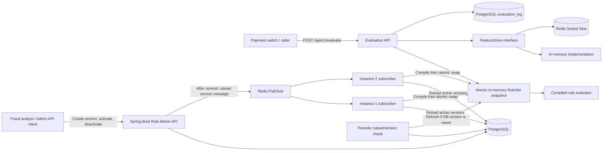

# Rulewright architecture

## Context and component view

> The diagram shows the intended multi-instance deployment. Each running application instance has its own in-memory snapshot and subscribes to the Redis change channel when `FEATURE_STORE=redis`.

## Evaluation request path

1. Validate the transaction request.
2. Check the persisted idempotency record for `transactionId`.
3. Read one immutable ruleset snapshot from `SnapshotHolder`.
4. Fetch behavioural feature values through `FeatureStore` when the request is new.
5. Evaluate compiled rules and apply `BLOCK > REVIEW > ALLOW` precedence.
6. Persist the decision, matched rule versions and ruleset version to `evaluation_log`.
7. Return the decision and evaluation timing.

The current implementation uses PostgreSQL for the durable evaluation log. Review the transaction/locking strategy and benchmark under concurrent load before claiming the target p95 latency.

## Rule activation and propagation

1. The admin API changes rule-version state and increments the PostgreSQL `ruleset_state.version` in one transaction.
2. After commit, the instance publishes the new version on Redis channel `fraud:ruleset:changed`.
3. Subscribers reload active rules from PostgreSQL, compile the complete ruleset, and call `SnapshotHolder.swapIfNewer`.
4. `swapIfNewer` uses an `AtomicReference` compare-and-set, so readers see either the previous complete snapshot or the next complete snapshot.
5. The scheduled refresh checks the database version periodically to recover from missed Pub/Sub messages. Older or duplicate revisions are ignored.

## Behavioural features

`FeatureStore` isolates feature retrieval and updates from Redis. The in-memory implementation supports Redis-free unit tests. The Redis implementation stores customer transaction events in sorted sets and uses a Lua script for atomic deduplication and update. The configured Redis connect/read timeout is 100ms. On feature-store failure, the documented policy is fail-open: feature-dependent conditions follow the rule engine's missing-feature policy while ordinary transaction fields can still be evaluated.

## Deployment boundary

`docker-compose.yml` starts PostgreSQL and Redis. The Spring Boot application is run on the host for local development, with connection settings supplied through environment variables. This repository snapshot does not include the Task 3 React UI.
